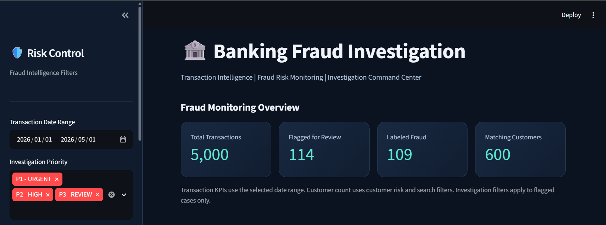
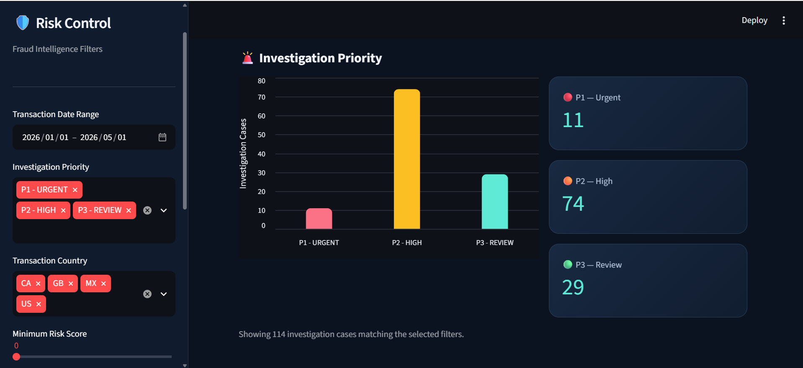
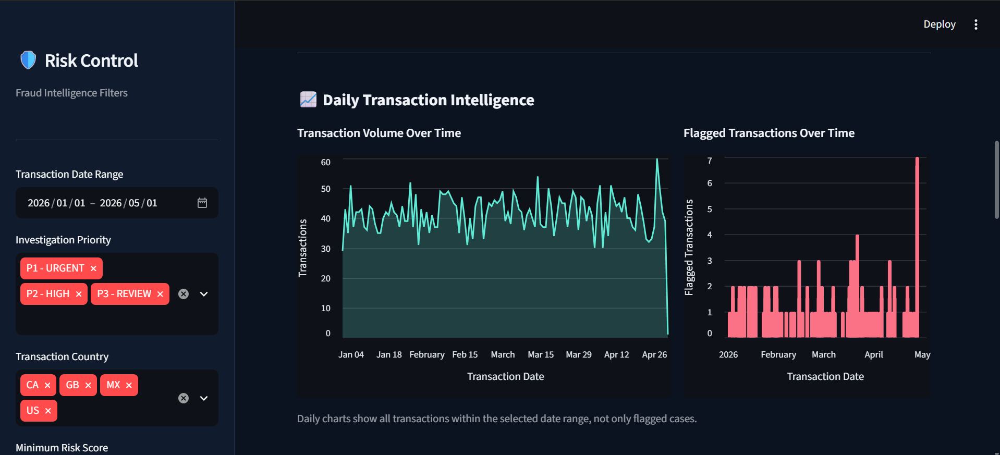
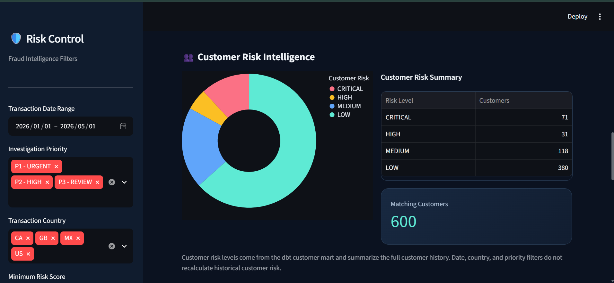
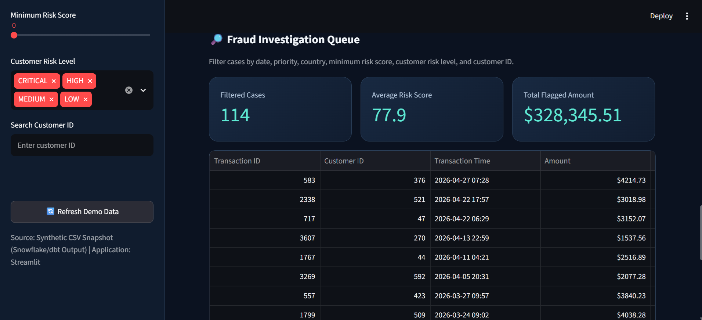

# Banking Fraud Investigation & Transaction Intelligence Platform

**End-to-End Data Engineering | Fraud Analytics | Transaction Intelligence | Business Intelligence**

An end-to-end banking analytics portfolio project demonstrating data engineering, analytical modeling, data quality validation, fraud-risk analysis, and capacity-constrained investigation prioritization.

**Technology Stack:** Python · SQL · SQLite · Snowflake · dbt Core · Streamlit · Power BI · GitHub Actions

The project uses **100% synthetic financial transaction data** and combines two complementary workstreams:

- **Banking Analytics Platform:** A reproducible 5,000-transaction dataset processed through analytical pipelines, data warehouse models, and interactive dashboards.
- **Fraud Investigation Research:** A separate analysis of 6.36 million PaySim transactions to evaluate fraud prioritization strategies under operational investigation constraints.

The objective is to demonstrate how financial transaction data can be transformed into reliable analytical datasets and used to support risk monitoring and investigation decisions.

---

## Live Interactive Dashboard

**[Launch Banking Fraud Intelligence Dashboard](https://banking-fraud-intelligence.streamlit.app/)**

The deployed Streamlit dashboard supports:

- Fraud monitoring KPIs
- Transaction trends
- Customer risk intelligence
- Investigation priority analysis
- Transaction-level investigation queues
- Interactive filtering and CSV exports

**Demo Mode:** The public dashboard uses synthetic CSV snapshots generated from the banking analytics pipeline. No Snowflake credentials are required.

The PaySim investigation experiments described below are separate analytical studies and are not presented as live dashboard features.

---

## 1. Business Problem

Financial institutions process large volumes of transactions and need reliable systems to identify potentially suspicious activity.

Two major challenges arise.

**Data Engineering Challenge**

Transaction data must be validated, transformed, reconciled, and organized into analytical models that support accurate reporting and investigation workflows.

**Fraud Operations Challenge**

Investigation teams have limited review capacity and must prioritize potentially suspicious transactions without knowing which transactions are fraudulent in advance.

This project explores both challenges through reproducible synthetic datasets and analytical experiments.

### Key Business Questions

1. How can transaction data be processed into reliable analytical datasets?
2. Which customers and transactions exhibit elevated fraud-risk indicators?
3. How can investigation teams prioritize suspicious transactions?
4. Which prioritization strategy captures more fraud labels under limited review capacity?
5. How does a 24-hour review deadline affect investigation outcomes?

A flagged or prioritized transaction is not necessarily confirmed fraud.

---

## 2. Project Architecture

### Workstream A — Banking Data Engineering and BI

```text
Synthetic Banking Transactions
              |
              v
      Python Data Pipeline
      - Data generation
      - Validation
      - Fraud-risk rules
              |
              v
        SQLite / Snowflake
        - Local analytics
        - RAW data
              |
              v
         dbt Core
         - Staging models
         - Analytical marts
         - Data quality tests
              |
              v
       Snowflake MARTS
              |
        +-----+-----+
        |           |
        v           v
     Streamlit    Power BI
     Dashboard    Dashboard
```

The project retains the original SQLite analytical workflow and extends the data engineering implementation with Snowflake and dbt.

### Workstream B — PaySim Fraud Investigation Research

```text
PaySim Synthetic Transactions
       6,362,620 Records
              |
              v
      Python Data Profiling
      - Fraud distribution
      - Transaction analysis
      - Balance behavior
              |
              v
     Investigation Eligibility
      TRANSFER / CASH_OUT
              |
              v
     Prioritization Strategies
        +-----------+
        |           |
        v           v
    Amount-Only   Draining + Amount
        |           |
        +-----+-----+
              |
              v
    Chronological Simulation
    - Hourly review scheduling
    - 1,000 reviews/day maximum
    - 24-hour alert deadline
              |
              v
       Cohort Evaluation
    - Fraud capture rate
    - Investigation precision
    - Review waiting time
    - Expired fraud alerts
    - Capacity utilization
              |
              v
      Business Case Study
      & Recommendations
```

The PaySim research uses a separate synthetic dataset and does not depend on the original 5,000-transaction analytical marts.

---

## 3. Technology Stack

| Technology | Purpose |
|---|---|
| Python | Transaction generation, validation, profiling, fraud prioritization, and simulation |
| SQL | Transaction analysis, reconciliation, and reporting |
| SQLite | Local analytical storage |
| Snowflake | Cloud data warehousing |
| dbt Core | SQL transformations, staging models, analytical marts, and tests |
| Streamlit | Interactive banking fraud analytics dashboard |
| Power BI | Business intelligence and investigation reporting |
| GitHub Actions | Automated project validation |
| Git / GitHub | Version control and source management |

---

## 4. Banking Analytics Dataset

The original banking analytics workstream uses a reproducible synthetic dataset generated with a fixed random seed.

### Dataset Results

| Metric | Result |
|---|---:|
| Total transactions | 5,000 |
| Flagged transactions | 114 |
| Labeled fraud transactions | 109 |
| Flagged transaction rate | 2.28% |
| Customers | 600 |
| dbt tests passed | 27 |

**Important:** Fraud labels and risk flags represent different concepts. A transaction flagged for investigation is not automatically confirmed as fraudulent.

---

## 5. Snowflake Data Warehouse

The Snowflake implementation organizes data into three logical layers:

```text
BANKING_FRAUD_DB
├── RAW
├── STAGING
└── MARTS
```

### Analytical Marts

| Model | Analytical Purpose |
|---|---|
| `MART_DAILY_TRANSACTION_INTELLIGENCE` | Daily transaction and fraud monitoring |
| `MART_CUSTOMER_RISK_SUMMARY` | Customer-level risk intelligence |
| `MART_HIGH_RISK_TRANSACTIONS` | High-risk transaction analysis |
| `MART_FRAUD_INVESTIGATION_QUEUE` | Investigation prioritization and reporting |

These models support transaction monitoring, customer risk analysis, and investigation reporting.

### dbt Transformations and Testing

dbt Core organizes SQL transformations into reusable analytical models.

The implementation includes data quality and reconciliation checks across analytical datasets.

**Validated implementation result: 27 dbt tests passed.**

---

## 6. Streamlit Fraud Intelligence Dashboard

The Streamlit application provides interactive analysis of synthetic banking transactions.

The public deployment uses CSV snapshots, while the locally configured application supports Snowflake-backed analytics when valid credentials are available.

### Dashboard Capabilities

- Transaction monitoring and fraud KPIs
- Customer risk segmentation
- Investigation priority filtering
- Daily transaction intelligence
- Transaction-level investigation queues
- Interactive charts and filters
- CSV export

### Dashboard Screenshots

#### Fraud Monitoring Overview



#### Investigation Priority



#### Daily Transaction Intelligence



#### Customer Risk Intelligence



#### Fraud Investigation Queue



---

## 7. Power BI Dashboard

The Power BI report provides three analytical pages.

### Page 1 — Executive Fraud Overview

Displays transaction KPIs and daily transaction and fraud trends.


### Page 2 — Fraud and Customer Risk Analysis

Displays investigation priority distribution and customer risk segmentation.


### Page 3 — Fraud Investigation Case Queue

Displays transaction-level information, including customer IDs, timestamps, transaction amounts, risk scores, and investigation priorities.


These dashboards demonstrate how analytical datasets can support fraud monitoring and investigation workflows.

---

## 8. PaySim Fraud Investigation Research

In addition to the original banking analytics platform, this project includes a separate fraud investigation research workstream using the PaySim synthetic mobile money dataset.

### PaySim Dataset Overview

| Metric | Result |
|---|---:|
| Total transactions | 6,362,620 |
| Fraud-labeled transactions | 8,213 |
| Overall fraud rate | Approximately 0.1291% |
| Simulated time steps | 743 |
| Hours per simulated day | 24 |
| Investigation-eligible types | TRANSFER and CASH_OUT |

The research investigates how different transaction prioritization strategies perform when manual investigation resources are limited.

### Investigation Strategies

**Strategy A — Amount-Only**

Prioritizes eligible transactions by transaction amount, with the largest amounts receiving the highest priority.

**Strategy B — Draining + Amount**

Prioritizes transactions exhibiting account-draining behavior before ranking by amount.

For this experiment, account draining means:

- The originating account had a positive balance.
- The originating account balance became zero.
- The transaction amount was at least the original balance.

Fraud labels are used only for retrospective evaluation, never for ranking.

### Research Stages

The project includes multiple complementary analytical experiments.

| Experiment | Purpose |
|---|---|
| Fraud profiling and threshold analysis | Explore transaction distributions and fraud-related patterns |
| Fraud strategy comparison | Compare alternative investigation prioritization rules |
| Chronological investigation prioritization | Evaluate investigation selection across development and holdout periods |
| Daily investigation comparison | Evaluate prioritization with daily review-capacity limits |
| Arrival-based investigation simulation | Evaluate chronological arrivals, review deadlines, and investigation outcomes |

Each experiment addresses a different analytical question. Results from different capacity and timing assumptions should not be treated as directly interchangeable.

---

## 9. Final Arrival-Based Investigation Experiment

The final experiment simulates investigation decisions as transactions arrive over time.

### Operational Assumptions

| Parameter | Configuration |
|---|---|
| Investigation capacity | Maximum 1,000 reviews per simulated day |
| Review schedule | Hourly |
| Alert deadline | 24 simulated hours |
| Evaluation method | Chronological arrival cohorts |
| Development/holdout boundary | PaySim step 323 |
| Prioritization strategies | Amount-only and draining + amount |

Transactions that are not reviewed within the simulated deadline are classified as expired.

The experiment measures investigation outcomes using the fraud labels associated with the reviewed transactions.

### Development Results

| Metric | Amount-Only | Draining + Amount |
|---|---:|---:|
| Eligible transactions | 1,951,895 | 1,951,895 |
| Eligible fraud labels | 3,643 | 3,643 |
| Reviews | 13,097 | 13,070 |
| Fraud labels captured | 1,150 | 1,348 |
| Investigation precision | 8.78% | 10.31% |
| Fraud capture rate | 31.57% | 37.00% |
| Expired fraud alerts | 2,493 | 2,295 |

### Exploratory Holdout Results

| Metric | Amount-Only | Draining + Amount |
|---|---:|---:|
| Eligible transactions | 818,514 | 818,514 |
| Eligible fraud labels | 4,570 | 4,570 |
| Reviews | 17,427 | 17,401 |
| Fraud labels captured | 1,976 | 2,210 |
| Investigation precision | 11.34% | 12.70% |
| Fraud capture rate | 43.24% | 48.36% |
| Expired fraud alerts | 2,594 | 2,360 |
| Average review wait | 7.83 hours | 8.07 hours |

### Key Analytical Finding

The draining + amount strategy reviewed **234 additional fraud-labeled transactions** compared with amount-only prioritization.

This represents:

- **11.84% relative improvement** in captured fraud labels.
- **5.12 percentage-point improvement** in fraud capture rate.
- Higher investigation precision.
- Fewer fraud-labeled alerts expiring without review.

These results were obtained using approximately the same review workload.

### Operational Capacity Findings

Across the complete simulation, including the final review window:

| Metric | Amount-Only | Draining + Amount |
|---|---:|---:|
| Available review slots | 31,918 | 31,918 |
| Completed reviews | 30,524 | 30,471 |
| Capacity utilization | 95.63% | 95.47% |

Despite high utilization, the simulation produced very large numbers of expired eligible transactions.

This indicates that investigation prioritization alone cannot resolve the mismatch between transaction volume and manual review capacity.

### Business Interpretation

Account-draining behavior was a useful prioritization signal within this synthetic experiment.

However, the dominant operational challenge was the excessive number of transactions entering the investigation queue.

A more mature fraud monitoring system would need stronger upstream alert screening, lifecycle management, and independent validation.

**Recommendation:** Retain account-draining behavior as a candidate risk feature for further research, but do not deploy the tested strategy based on these synthetic results.

### Research Limitations

- PaySim is synthetic and may contain generator-specific fraud patterns.
- The 24-hour deadline and 24/7 review schedule are simulated assumptions.
- Reviewed fraud labels do not establish fraud prevention or recovered financial losses.
- The holdout data was examined in earlier experiments and is not an untouched independent validation set.
- The investigation simulation does not model full case management, analyst staffing costs, or regulatory workflows.

**Detailed case study:** [Arrival-Based Fraud Investigation Business Case Study](docs/paysim_arrival_investigation.md)

---

## 10. Running the Project

### Prerequisites

- Python and pip
- Git
- Project dependencies installed locally
- Snowflake credentials only when running Snowflake-backed functionality

### Clone the Repository

```bash
git clone https://github.com/Meghana2301/Banking-Fraud-Investigation-Transaction-Intelligence-Platform.git
cd Banking-Fraud-Investigation-Transaction-Intelligence-Platform
```

### Install Dependencies

```bash
python -m pip install -r requirements.txt
```

### Generate the Original Synthetic Dataset

```bash
python -m src.pipeline --rows 5000 --seed 42
```

### Run Python Tests

```bash
python -m unittest discover -s tests -v
```

### Launch Streamlit

```bash
streamlit run app.py
```

### Run the PaySim Arrival-Based Investigation

The PaySim research requires a separate dataset file.

Place the PaySim CSV at:

```text
data/external/PS_20174392719_1491204439457_log.csv
```

Then run:

```bash
python scripts/paysim_arrival_investigation.py
```

The script evaluates the prioritization strategies and prints development, holdout, and investigation-capacity metrics.

**Data availability:** The PaySim source dataset is not included in the GitHub repository. Users must obtain it separately.

### Snowflake and dbt

Snowflake-backed execution requires a configured Snowflake account, appropriate database permissions, and valid credentials.

Never commit Snowflake credentials, passwords, access tokens, or other secrets to GitHub.

---

## 11. Data Quality and Reproducibility

The project demonstrates several data quality and engineering practices:

- Reproducible synthetic transaction generation
- Data validation and reconciliation
- SQL analytical modeling
- dbt data quality testing
- Automated Python testing
- Chronological evaluation
- Separate development and holdout reporting
- Explicit investigation-capacity constraints
- Fraud-label evaluation without using labels in prioritization
- Transparent documentation of experimental limitations

The original analytics dataset and PaySim research dataset are intentionally kept separate to avoid mixing incompatible data populations or reporting metrics.

---

## 12. Key Project Achievements

**Data Engineering**

- Developed a reproducible synthetic banking transaction pipeline.
- Implemented SQL analytics and local SQLite processing.
- Created Snowflake analytical layers and dbt transformation models.
- Validated analytical models with 27 passing dbt tests.

**Business Intelligence**

- Developed interactive fraud monitoring and investigation dashboards.
- Built transaction-level reporting and customer risk views.
- Published a Streamlit demonstration using synthetic data.

**Fraud Analytics**

- Profiled 6.36 million synthetic PaySim transactions.
- Compared rule-based fraud investigation prioritization strategies.
- Implemented chronological, capacity-constrained investigation simulations.
- Evaluated fraud capture, precision, expiration, and review delays.
- Identified operational alert volume as a major limitation.

**Business Analysis**

- Translated technical findings into investigation performance metrics.
- Evaluated tradeoffs between capture rates and review waiting time.
- Developed recommendations for upstream screening and independent validation.

---

## 13. Future Enhancements

Potential future improvements include:

- Apache Airflow orchestration
- PySpark-based distributed transaction processing
- Machine learning-based fraud scoring
- More selective alert-generation rules
- Analyst staffing and investigation cost modeling
- Additional alert lifecycle and SLA metrics
- Independent evaluation using representative unseen data
- Automated refresh of analytical dashboards

These are future enhancements, not currently implemented production capabilities.

---

## 14. Disclaimer

This is an independent educational and portfolio project using synthetic data only.

It is not a production banking platform and does not use real customer information, employer-owned datasets, or proprietary banking systems.

Fraud-risk scores, prioritization rules, investigation outcomes, and analytical recommendations are illustrative.

The PaySim investigation findings are exploratory and do not establish real-world fraud prevention effectiveness, financial savings, or suitability for deployment without further validation.