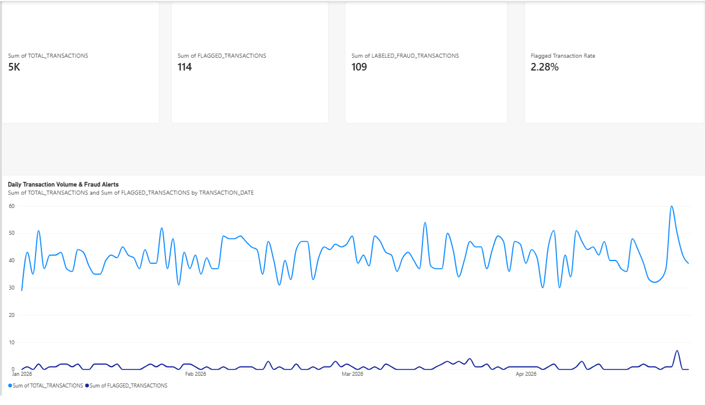
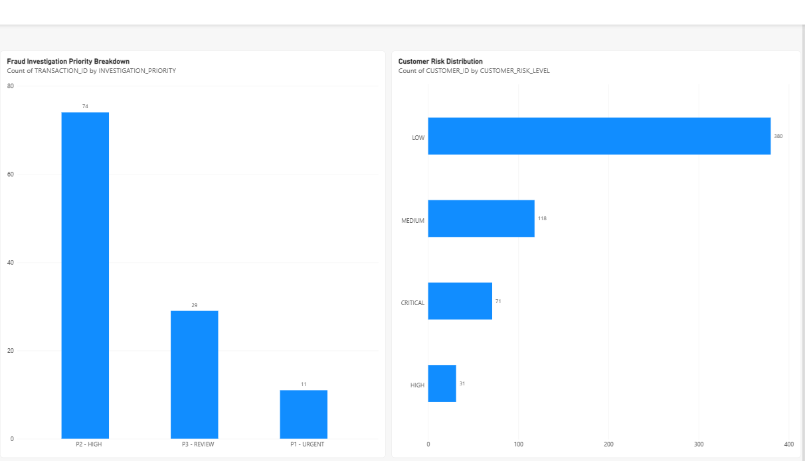
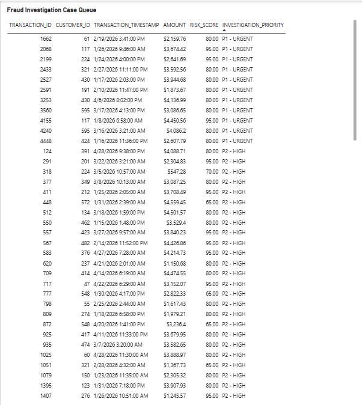

# Banking Fraud Investigation & Transaction Intelligence Platform

An end-to-end banking fraud analytics portfolio project using **Python, SQL, SQLite, Snowflake, dbt, Streamlit, and Power BI**.

This project uses **100% synthetic banking data** to demonstrate data engineering, fraud-risk analytics, data quality testing, and business intelligence reporting.

## Project Overview

The platform simulates banking transactions, evaluates fraud-risk indicators, transforms data into analytical models, and presents insights through interactive dashboards.

It is designed to support three analytical questions:

- How many transactions are flagged for potential fraud?
- Which customers and transactions require closer investigation?
- How can investigators prioritize suspicious transactions?

**Important:** A flagged transaction indicates that additional review may be needed. It does not establish confirmed fraud.

## Architecture

```text
Synthetic Banking Transactions
             |
             v
    Python Data Pipeline
    - Data generation
    - Validation
    - Fraud-risk rules
             |
             v
    SQLite / Snowflake
    - Analytical storage
    - RAW data
             |
             v
      dbt Transformations
    - Staging models
    - Analytical marts
    - Data quality tests
             |
             v
       Snowflake MARTS
             |
       +-----+-----+
       |           |
       v           v
    Streamlit    Power BI
    Dashboard    Dashboard
```

The project retains the original SQLite analytical workflow and extends the platform with Snowflake and dbt.

## Technology Stack

| Technology | Purpose |
|---|---|
| Python | Synthetic data generation, validation, and risk processing |
| SQL | Data analysis, reconciliation, and reporting |
| SQLite | Local analytical database |
| Snowflake | Cloud data warehouse |
| dbt Core | Data transformations and analytical models |
| Streamlit | Interactive fraud monitoring dashboard |
| Power BI | Business intelligence and investigation reporting |
| GitHub Actions | Automated project testing |
| Git / GitHub | Version control and project collaboration |

## Dataset and Results

The project uses a reproducible synthetic dataset generated with a fixed random seed.

| Metric | Result |
|---|---:|
| Total Transactions | 5,000 |
| Flagged Transactions | 114 |
| Labeled Fraud Transactions | 109 |
| Flagged Transaction Rate | 2.28% |
| Customers | 600 |
| dbt Tests Passed | 27 |

Fraud labels and risk flags are separate concepts and should not be treated as interchangeable.

## Snowflake Data Warehouse

The Snowflake implementation uses the following database structure:

```text
BANKING_FRAUD_DB
├── RAW
├── STAGING
└── MARTS
```

The analytical marts include:

1. `MART_DAILY_TRANSACTION_INTELLIGENCE`
2. `MART_CUSTOMER_RISK_SUMMARY`
3. `MART_HIGH_RISK_TRANSACTIONS`
4. `MART_FRAUD_INVESTIGATION_QUEUE`

These models support daily monitoring, customer risk analysis, high-risk transaction analysis, and investigation prioritization.

## dbt Transformations and Testing

dbt Core is used to organize SQL transformations into reusable analytical models.

The project includes data quality and reconciliation tests for the analytical marts.

**Validation result:** 27 dbt tests passed during the project implementation.

## Streamlit Dashboard

The Streamlit application connects to Snowflake analytical marts and provides interactive fraud analysis.

Key capabilities include:

- Transaction and fraud monitoring
- Customer risk analysis
- Investigation priority filtering
- Transaction-level investigation queue
- Interactive filters and charts
- CSV export for investigation results

## Power BI Dashboard

The Power BI report provides three analytical pages.

### Page 1 — Executive Fraud Overview

Displays transaction KPIs and daily transaction and fraud trends.



### Page 2 — Fraud and Customer Risk Analysis

Displays investigation priority distribution and customer risk segmentation.



### Page 3 — Fraud Investigation Case Queue

Displays individual transactions, customer IDs, timestamps, transaction amounts, risk scores, and investigation priorities.



The investigation queue supports prioritization of urgent cases for further review.

## Quick Start

### 1. Install dependencies

```bash
python -m pip install -r requirements.txt
```

### 2. Run the synthetic transaction pipeline

```bash
python -m src.pipeline --rows 5000 --seed 42
```

### 3. Run Python tests

```bash
python -m unittest discover -s tests -v
```

### 4. Launch the local Streamlit dashboard

```bash
streamlit run dashboard/app.py
```

The Snowflake-backed dashboard requires valid Snowflake credentials and access to the analytical marts. Credentials must be supplied securely through environment configuration and must never be committed to GitHub.

The Snowflake and dbt workflows require additional account configuration.

## Project Highlights

- Built a reproducible synthetic banking transaction pipeline
- Implemented rule-based fraud-risk analysis
- Developed cloud analytical models using Snowflake and dbt
- Added automated data quality and reconciliation checks
- Created interactive fraud dashboards in Streamlit and Power BI
- Developed a transaction-level investigation queue with risk-based prioritization
- Used GitHub for version control and automated testing

## Future Enhancements

Potential future improvements include:

- Apache Airflow orchestration
- PySpark-based distributed processing
- Machine learning model development and evaluation
- Automated dashboard refresh and deployment
- Additional fraud investigation metrics and alerting

These are future enhancements, not implemented production capabilities.

## Disclaimer

This is an independent educational and portfolio project using synthetic data only.

It is not a real banking deployment. No actual banking or customer data, proprietary employer information, or production banking systems are used.

Fraud-risk scores and investigation priorities are illustrative and are not suitable for real-world financial decisions without further validation.